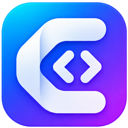

# Coodoo

### Your idea, built by Claude Code and Codex.

A software team on your own computer. You say what you want; two AI developers research, design, build, test and review it, and put it on GitHub.

**[Download the latest version →](https://github.com/TheFactoryGuy/coodoo-releases/releases/latest)**

---

## Made for people with ideas, not for people with terminals

You don't need to be a programmer to use Coodoo. You write what you want in plain language, such as *"A login page with email and password"*. Coodoo turns it into a plan, builds it step by step, checks its own work and keeps your code safe on GitHub.

Every screen explains what a button will do before you press it. Bigger actions, like releasing a new version of your app, are guided step-by-step flows. Missing tools are installed for you, and when a command has to run, Coodoo runs it for you with one click. There is a built-in terminal for when you want it, but you never need it.

## What Coodoo does for you

### 🧑‍💻 A real team, not a chatbot
Coodoo gives every goal to a team with four roles: **developer**, **researcher**, **designer** and **reviewer**. You choose which AI fills each role, Claude Code or Codex. One AI builds, the other checks the work. If one of them gets stuck or hits its limit, the other takes over.

### 🚀 Autopilot from idea to finished code
Put goals in a queue and press start. For each goal Coodoo works through the steps a good team would:

1. **Research**: how does the project work, and what is the best approach?
2. **Design**: screens, flows and icons (only when the goal changes what users see).
3. **Plan**: a technical design, split into small tasks.
4. **Build, run, review**: each task is built, the app is started and looked at, and the reviewer approves or asks for fixes.
5. **Finish**: version number, changelog, and everything on GitHub.

A quick check at the start decides which steps a goal really needs, so a small fix goes straight to work. You can pause at any time and pick up exactly where the agents were, even after closing your laptop.

### 👀 It looks at your app, like a person would
After every task Coodoo starts your app and checks that it really works: it opens your website and looks at the page, runs your command-line tool, or runs your library's tests. If something is broken, the developer fixes it first.

### 🗺️ Project map: the agents know their way around
Coodoo reads your code and keeps a map of what is where and what depends on what, for every programming language. The agents can even search it **by meaning** ("where do we check the password?"), with a small AI model that runs on your own computer. They ask the map instead of searching file after file, which makes them faster and cheaper. You can explore the same map yourself on the **Project map** page.

### 🎓 It learns from its mistakes
When a review rejects work, or a goal fails, Coodoo remembers the lesson next to the files involved. The next time an agent works on those files, it gets the lesson, so the same mistake doesn't happen twice.

### 🔐 Security like an experienced developer
Coodoo watches for what beginners easily miss: passwords and keys in the code, vulnerable dependencies (with Dependabot), unsafe patterns in logins, payments, uploads and databases, and personal data that leaks into logs. Critical security problems are fixed before any other work.

### 🌿 Neat on GitHub
Every goal gets its own branch, every commit is made **in your name** (never in the AI's), and finished work is merged into your main branch in three guided steps, with conflicts resolved, tests run and the result reviewed. Protected branches go through a pull request automatically.

### 🛤️ Flows: development → staging → main
Pick a flow for your project, such as *development → staging → main*. The autopilot always works on the first branch; with **Promote** the work moves one step on, never skipping one. Coodoo reads your branch rules on GitHub and follows them: a pull request where one is required, waiting for checks, and telling you plainly when someone else has to approve. When you save the flow, Coodoo also puts it on GitHub as branch rules, so everyone follows it.

### 💻 Working on more than one computer
**Get latest** brings in what you built on your other computer. An agent first checks what is new on both sides, your own work is saved on a backup branch, and conflicts are merged for you, so nothing gets overwritten.

### 📦 Release your app
Build your app and publish a new version in three steps: choose the version, choose where it goes (GitHub Releases in the same or another repository, or your own S3-compatible storage), and press release. Coodoo writes the release notes from your commits.

### 🗝️ A vault for your keys
API keys, tokens and other secrets go into the project vault: encrypted with your computer's keychain, never shown again, never sent to the agents' instructions and blanked out as `REDACTED` everywhere they could appear. Coodoo even refuses to commit a file that contains one.

### ⚙️ Your app's settings, without opening files
Coodoo finds your app's `.env` files and their examples. For each line you type a value or pick a key from the vault. A key from the vault can be handed to your app only when Coodoo starts it, so it is never stored in a file.

### 🧩 Services: Laravel Herd, Docker and databases
Tell Coodoo which services your project uses: Laravel Herd, Docker, MySQL, PostgreSQL, Redis, or your own. Coodoo suggests them from your project, starts them before your app, uses their tools for the agents and fills in suggestions such as `APP_URL` and `DB_PORT`. Different ports are fine.

### ▶️ Commands with one click, and a terminal if you want one
When something has to run, such as `npm run db:migrate`, you get a card with **Let Coodoo do this**. Coodoo checks the command first and runs it with the right tools. For when you want to type yourself, there's a built-in **terminal** that only works inside your project folder.

### 💬 And more
- **Chat** with an agent about your project without changing anything; new goals are made right there, together with the agent.
- **Extra tools for the agents** through MCP servers and plugins, such as up-to-date documentation or a browser.
- **Statistics** on time, tokens and costs per goal.
- **English and Dutch**, with built-in help for every screen (press F1).
- **Automatic updates**: Coodoo tells you when a new version is out.

## Safety rules that are always on

The agents work on your code on their own, so Coodoo enforces hard limits that no goal, agent or button can switch off:

- Your repository is **never deleted**, archived, transferred or made public.
- Pushed history is **never rewritten**: no force pushes, no deleted branches or tags.
- No destructive git commands, and no committing a mass deletion of files.
- The agents never get your GitHub login, and can only write inside your project folder.
- Keys and tokens never end up in a commit.
- With a flow, work only reaches a later branch through the flow.

## What you need

| | |
|---|---|
| **A computer** | macOS (Apple silicon or Intel) or Windows (x64 or ARM) |
| **An AI subscription** | Claude (for Claude Code) and/or ChatGPT (for Codex). One is enough; with both, one builds and the other reviews |
| **A GitHub account** | Your code lives here |
| **A Coodoo license** | Asked for when you first start the app |

Coodoo installs Claude Code, Codex and the tools your project needs (such as Node.js or Python) for you, with the official installers.

## Download and install

1. Go to the **[latest release](https://github.com/TheFactoryGuy/coodoo-releases/releases/latest)** and download the file for your computer:
   - **Mac with Apple silicon** (M1 and newer): `Coodoo-x.y.z-arm64.dmg`
   - **Mac with Intel**: `Coodoo-x.y.z.dmg`
   - **Windows**: `Coodoo-Setup-x.y.z.exe`
2. **Mac**: open the dmg and drag Coodoo to your Applications folder. **Windows**: run the installer.
3. Start Coodoo, enter your license key, and follow the welcome screen. It walks you through connecting the agents and GitHub.

**Opening Coodoo for the first time**

- **macOS** may say that Apple can't check Coodoo. Open **System Settings → Privacy & Security**, scroll down and click **Open Anyway**. You only need to do this once.
- **Windows** may show *Windows protected your PC*. Click **More info → Run anyway**.

## Updates

Coodoo checks for new versions by itself. On **Windows** the update downloads in the background and installs with one click. On **macOS** Coodoo tells you a new version is ready and opens the download for you. A running autopilot is paused first, so no work is lost.

All versions and what changed in each are on the **[releases page](https://github.com/TheFactoryGuy/coodoo-releases/releases)**.

---

© 2026 TheFactoryGuy · Coodoo is not affiliated with Anthropic or OpenAI. Claude Code is a product of Anthropic; Codex is a product of OpenAI.

